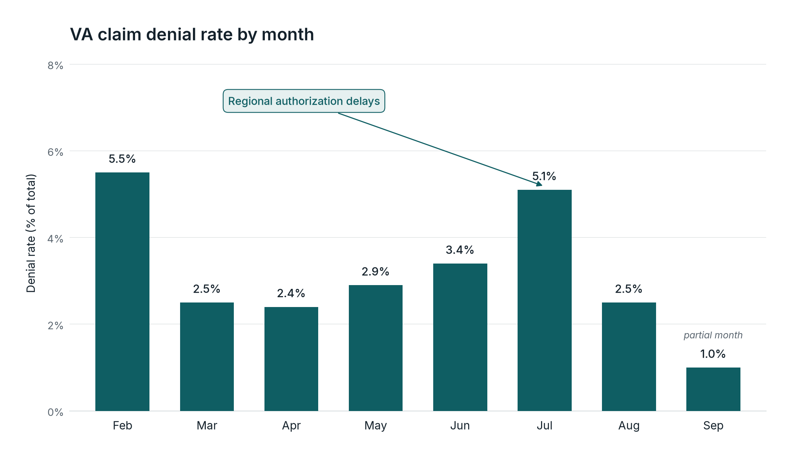

# [Your Name]

Product Manager in healthtech.  
I turn messy payer and care-delivery rules into systems that get patients care and get providers paid.

**Live site:** [https://cionale03-hub.github.io](https://cionale03-hub.github.io)

**Target roles:** Product Manager, Senior Product Manager, and Product Owner in healthtech.

## Featured case study

**[Rebuilding CareLinx's VA Care-to-Cash Lifecycle](case-studies/va-care-to-cash.md)**  
From referral intake to paid claim, across two VA payers. Role: Product Manager, CareLinx.

VA home care runs on referrals authorizing fixed weekly hours for Respite and Home Health Aide care. Hours change mid-period, expire after 180 days, and often need extensions while a new authorization is pending. Intake, voucher balances, shift booking, and claims ran separately, so authorized hours, delivered care, and billed claims drifted apart, causing denials and revenue at risk.

**Headline results**

- Monthly finalized VA payments grew 64% over seven months ($2.7M to $4.4M).
- Denial rate held at 2–3% from March through August, down from 5.5% in February.
- ~$26M finalized claims, February–August.
- ~$621K pending-authorization revenue, of which $594.9K (August–October) is still within the 90-day window.

[Read the case study](case-studies/va-care-to-cash.md)

## Portfolio

- [Case studies](case-studies/)
- [Artifacts](artifacts/) — [care-to-cash flow](artifacts/care-to-cash-flow.md), [referral validation rules](artifacts/referral-validation-rules.md), [denial rate chart](artifacts/denial-rate-chart.png)

## Core skills

- Payer authorization
- Claims and revenue cycle
- Systems design
- Requirements
- Root-cause analysis
- Cross-functional leadership

## Contact

- Email: [email]
- LinkedIn: [LinkedIn]
- Résumé: place the PDF at `resume/resume.pdf` ([note](resume/README.md))
