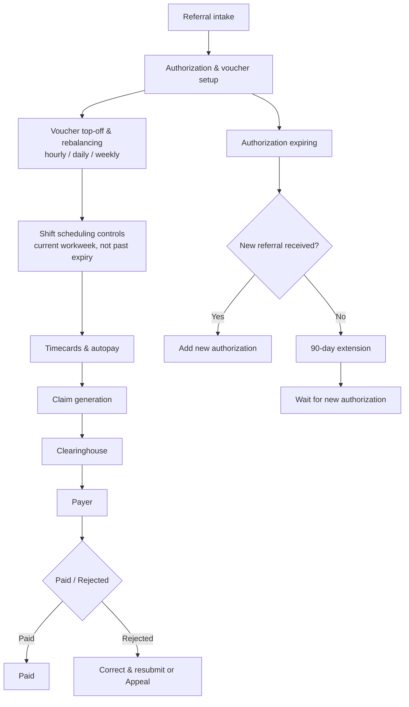

# Care-to-cash flow

Sanitized lifecycle from referral intake to a paid or rejected claim, including the branch when an authorization is expiring.

The lifecycle runs from referral intake into authorization and voucher setup, then voucher top-off and rebalancing on hourly, daily, and weekly schedules. Shift scheduling is limited to the current workweek and cannot pass authorization expiry; timecards and autopay follow, and claim generation sends the claim through the clearinghouse to the payer, where it is paid or rejected and then corrected and resubmitted or appealed. When an authorization is expiring, a new referral adds a new authorization; if none has arrived, a 90-day extension is used while waiting for a new authorization.
